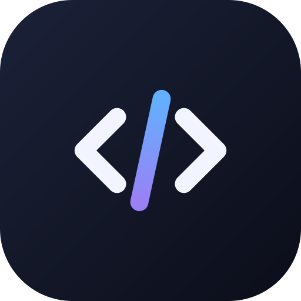

<p align="center">
  
</p>

# ByteCode

A focused, offline code editor for Android. Real files, a real editor (CodeMirror 6), a console, and
first-class **Luau** support with a native runtime built from the official Luau sources. No account, no
network, no permissions.

## Features

**Opens from anywhere** — ByteCode appears in Android's *Open with* / *Edit with* chooser for any file
(`content://` and `file://`), so you can open a script straight from a file manager, a download or another app.
A welcome screen with *Open folder*, *Open file* and recent files shows when no file is open.

**File explorer** (Storage Access Framework — no storage permission, no `MANAGE_EXTERNAL_STORAGE`)
- Lazy folder tree, expand/collapse, workspace folder remembered across launches
- Create file/folder, rename, delete, copy/cut/paste, import files, export a file
- Official language logos per file type (Simple Icons, Material Design Icons), long-press context menu, adjustable width on wide screens

**Editor** (CodeMirror 6 in one WebView, bundled locally, fully offline)
- Tabs with unsaved-change dots; each tab keeps its undo history, selection, folds and scroll position
- Syntax highlighting, line numbers, current-line highlight, bracket matching and auto-closing, automatic
  indentation, code folding, comment toggling, undo/redo, find and replace, go to line
- Basic autocomplete: language-specific where the language pack provides it, plus words from the document
- Font size, font family (system, Courier, or an imported .ttf/.otf), tab size, spaces/tabs, word wrap, themes
- Extra-keys bar (Tab, undo/redo, arrows with key repeat, code symbols) that never closes the soft keyboard
- Autosave (off / after a delay / when leaving the file), crash-safe recovery copies of unsaved text

**Console** — Output, Problems, Search and Log channels; resizable and collapsible; clickable errors jump to the line

**Luau** — dedicated tokenizer (types, generics, interpolation, `continue`, Roblox globals/methods),
Roblox API suggestions (a curated subset) and snippets, syntax diagnostics from the official parser, and a
standalone runtime on the official VM with Stop, timeout and memory limit. See [docs/LUAU_RUNTIME.md](docs/LUAU_RUNTIME.md).

**Running code**

| Language | How it runs | Notes |
|---|---|---|
| Luau, Lua | Native Luau VM (JNI) | Standalone Luau — **not** the Roblox engine; Roblox globals raise a clear error |
| JavaScript | Hidden WebView (device Chromium) | `console.*` captured, no network, ends when no timers are pending |
| Shell | Device `/system/bin/sh` | Only the commands that ship with Android |

Other languages have highlighting and editing only; there is no Run button for them.

**Also:** command palette, go to file, recent files/folders, search in files (plain/case/regex),
hardware-keyboard shortcuts, dark/light/system theme and accent colours (8 presets or a custom hex).

## Supported languages

| Language | Extensions | Highlighting | Notes |
|---|---|---|---|
| HTML | `.html` `.htm` | `@codemirror/lang-html` | |
| CSS | `.css` | `lang-css` | |
| JavaScript / JSX | `.js` `.mjs` `.cjs` `.jsx` | `lang-javascript` | runnable |
| TypeScript / TSX | `.ts` `.mts` `.cts` `.tsx` | `lang-javascript` | not runnable |
| JSON | `.json` `.jsonc` | `lang-json` | syntax errors underlined |
| Python | `.py` `.pyw` | `lang-python` | not runnable |
| Java | `.java` | `lang-java` | |
| Kotlin | `.kt` `.kts` | legacy mode (clike) | |
| C / C++ | `.c` · `.cpp` `.cc` `.cxx` `.h` `.hpp` `.hh` `.hxx` | `lang-cpp` | not runnable |
| C# | `.cs` | legacy mode (clike) | |
| PHP | `.php` | `lang-php` | |
| Ruby | `.rb` | legacy mode | |
| Go | `.go` | legacy mode | |
| Rust | `.rs` | `lang-rust` | |
| SQL | `.sql` | `lang-sql` | |
| Shell | `.sh` `.bash` `.zsh` | legacy mode | runnable |
| Lua | `.lua` | legacy mode | runs on the Luau VM |
| **Luau** | `.luau` | **dedicated tokenizer** | completion, diagnostics, runnable |
| Markdown | `.md` `.markdown` | `lang-markdown` | |
| YAML | `.yml` `.yaml` | legacy mode | |
| XML | `.xml` `.svg` `.xsd` `.xsl` | `lang-xml` | |
| Plain text | `.txt` `.log` … | – | |

## Technology stack

| Part | Choice | Version (see `gradle/libs.versions.toml`) |
|---|---|---|
| Language / UI | Kotlin, Android Views, Material 3 | Kotlin 2.0.21, Material 1.12.0 |
| Build | Gradle, Android Gradle Plugin | Gradle 8.10.2, AGP 8.7.3 |
| SDK | compile 35, target 34, min 26 | NDK 27.0.12077973, CMake 3.22.1 |
| Editor | CodeMirror 6 (esbuild bundle) | `^6` ranges resolved by `npm install` |
| Luau | Official Luau, cloned at build time | tag in `luau/LUAU_VERSION` (`0.680`) |
| Files | Storage Access Framework (`DocumentsContract`) | – |
| Async | Kotlin coroutines | 1.9.0 |
| Settings UI | AndroidX Preference | 1.2.1 |
| CI | GitHub Actions | `.github/workflows/build.yml` |

No other libraries. The app requests **no permissions** and never touches the network.

## Repository layout

```
ByteCode/
├── .github/workflows/build.yml     CI: tests, APK build, artifact upload, release attachment
├── app/                            Android application (UI, files, runners, settings)
├── editor/                         Editor module: WebView host + bridge (Kotlin)
│   └── web/                        CodeMirror 6 bundle sources (JavaScript) + unit tests
├── luau/                           Luau module: JNI library (C++) + runtime manager (Kotlin)
│   └── native/                     CMake build, native sources, tests
├── docs/                           ARCHITECTURE, LUAU_RUNTIME, TEST_PLAN, ORIGINAL_SPEC (the owner's spec)
├── scripts/static-check.py         Source consistency checker (not a compiler)
├── scripts/ci/                     CI helpers: Android SDK setup, workflow guard, failure digest, self-tests
├── BYTECODE_HANDOFF.md             Development handoff for continuing in a new chat
├── MANIFEST.sha256                 SHA-256 of every source file in this snapshot
└── gradle/, settings.gradle.kts, build.gradle.kts, gradle.properties, gradlew
```

## Building

### Prerequisites
JDK 17, Android SDK platform 35 with build-tools 34.0.0 and 35.0.0, NDK `27.0.12077973`, CMake `3.22.1`, Node.js 18+,
Git, and network access on the first build (npm registry, github.com).

### Command line
```sh
./gradlew :app:assembleDebug        # downloads gradle-wrapper.jar on first use (needs curl or wget)
# or, with Gradle 8.10+ installed:  gradle :app:assembleDebug
```
APK: `app/build/outputs/apk/debug/app-debug.apk`. The first build clones Luau, runs `npm install`,
bundles the editor with esbuild (`editor/src/main/assets/editor/dist`) and compiles the native library.
Android Studio (Ladybug or newer) can open the folder directly.

Useful properties (`-P…` or `gradle.properties`):

| Property | Effect |
|---|---|
| `bytecode.abis=arm64-v8a` | Build only these ABIs (default `arm64-v8a,armeabi-v7a,x86_64`) |
| `bytecode.luauTag=<tag>` | Use another Luau release tag |
| `bytecode.skipEditorBundle=true` | Skip npm/esbuild (only if `dist/` already exists) |
| env `BYTECODE_MINIFY=1` | Minify the editor bundle (the release workflow does) |

### Release signing
Without secrets the release APK is signed with the debug key so it installs. For a real key set the
environment variables `BYTECODE_KEYSTORE_FILE`, `BYTECODE_KEYSTORE_PASSWORD`, `BYTECODE_KEY_ALIAS`,
`BYTECODE_KEY_PASSWORD` (the workflow builds the file from the secret `BYTECODE_KEYSTORE_BASE64`).

## GitHub Actions

`.github/workflows/build.yml`

* **Triggers:** push to `main`/`master`, tags `v*`, pull requests, published releases, and manual runs
  (`workflow_dispatch`, with a *debug/release* choice).
* **quick-tests:** the CI helper self-tests and workflow guard (`scripts/ci`), editor unit tests (Node), native
  helper tests (g++ with sanitizers), native type-check against API stubs, and the static source check.
* **build:** the runner's own Android SDK, with platform 35, build-tools, NDK and CMake installed and verified by
  `scripts/ci/setup-android-sdk.sh` (no third-party SDK action; see below), then JDK 17, Node 20, Gradle 8.10.2 and
  `:app:assembleDebug` or `:app:assembleRelease` (with `--continue`); fails if no APK was produced.
* **Output:** the APK is uploaded as a workflow artifact; APKs are attached to a GitHub release for `release`
  events and `v*` tags. When a build fails, the run's **Summary** page shows a short *Build failure digest* (the
  error lines and Gradle's "What went wrong"), and the full logs (`ci-logs`) and Gradle reports
  (`build-reports`) are uploaded as artifacts.
* **Rules:** `scripts/ci/check-workflow.py` fails the quick tests if the workflow uses `android-actions/setup-android`
  (its default step asks `sdkmanager` for the removed package `tools`, which failed the first run) or any
  third-party action that is not on its allow-list, or if the versions in `build.yml` differ from the Gradle files.

To use it: push the repository to GitHub, open **Actions → Build ByteCode → Run workflow**, then download
the artifact. For signed releases add the four `BYTECODE_*` secrets described above.

## Project status

Version **1.0.0**. CI (`.github/workflows/build.yml`) builds the APK on every push; open **Actions → Build ByteCode**
and download the artifact.

**Checks that run without an Android toolchain** (also part of the `quick-tests` CI job):
- 55 JavaScript unit tests: Luau tokenizer, completion analysis, editor/bridge glue, identifiers, scrollbars
- Native UTF-8/UTF-16 conversion test under AddressSanitizer/UBSan; native C++ type-check against API stubs
- Every Android XML resource is well-formed and every `R.*` reference resolves; Kotlin imports, JNI names,
  enum values and listener implementations match (`scripts/static-check.py`)
- Workflow guard and CI helper self-tests (`scripts/ci`)

Gradle, Kotlin compilation, the NDK build and on-device behaviour are verified by the CI build and by running the
APK. Work through [docs/TEST_PLAN.md](docs/TEST_PLAN.md) on a device before each release.

## Known limitations

* No minimap and no breadcrumbs (not implemented; nothing in the UI pretends otherwise)
* Syntax diagnostics only — no Luau type checking; only JSON and Luau are linted
* The Roblox API data is a hand-written subset, not generated from Roblox's API dump
* Python, C/C++, TypeScript and other languages cannot be run on the device
* `require` is unavailable in the standalone Luau runtime; each script is one file
* A custom accent colour is exact in the editor and custom views; stock Material widgets use the nearest preset
* The explorer width is adjustable only in the docked (wide) layout
* External changes to open files are not detected; saving overwrites the file
* Files over 2 MB open as plain text; over 20 MB are refused; non-UTF-8 files open read-only
* `MainActivity` is large (about 1,000 lines) and should be split

## Future plans

Link the Luau analysis library for type errors and lint; generate the Roblox API data from the API dump;
a workspace-aware `require`; a terminal; Git integration; a minimap and breadcrumbs; more themes.

## Developer tools

```sh
cd editor/web && node --test            # editor unit tests (no npm install needed)
sh luau/native/tests/syntax-check.sh    # native type-check against API stubs
python3 scripts/static-check.py         # source consistency checks
python3 scripts/ci/check-workflow.py    # CI workflow guard (forbidden actions, versions in step)
bash scripts/ci/test-ci-scripts.sh      # self-tests of the CI helper scripts
sha256sum -c MANIFEST.sha256            # verify this snapshot
```

## Licence and credits

MIT — see [LICENSE](LICENSE). Third-party components and their licences: [THIRD_PARTY_LICENSES.md](THIRD_PARTY_LICENSES.md).
Language logos come from [Simple Icons](https://simpleicons.org) (CC0) and interface icons from
[Material Design Icons](https://pictogrammers.com/library/mdi/) (Apache 2.0). Logos are trademarks of their owners and are
used only to identify file types.
